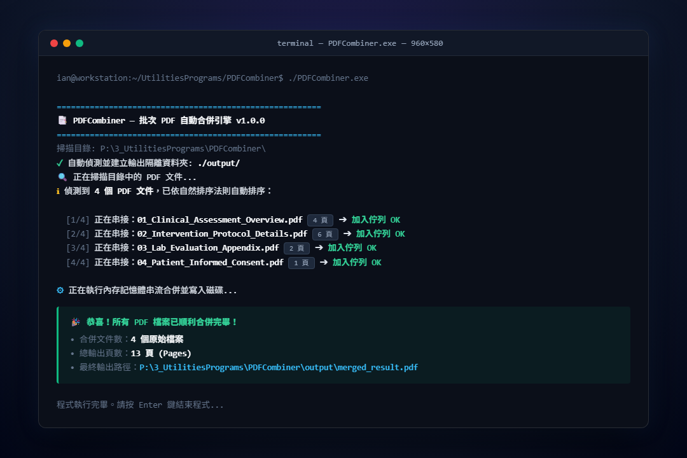
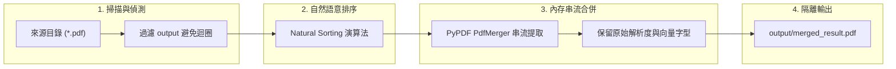

<div align="center">

# 📑 PDFCombiner

**High-Performance Batch PDF Merge Engine with Natural Sequence Alignment**

[](https://github.com/ian030590/PDFCombiner/stargazers)
[](https://opensource.org/licenses/MIT)
[](https://www.python.org/)
[](https://github.com/ian030590/PDFCombiner)
[](https://github.com/ian030590/PDFCombiner/pulls)

<br />

<p align="center">
  
</p>

<p align="center">
  <b>極速、純本機、零雲端依賴的批次 PDF 智慧合併工具，支援自然檔名智慧排序與隔離目錄安全輸出。</b>
</p>

</div>

---

## 📖 目錄 (Table of Contents)

- [產品簡介 (Overview)](#-產品簡介-overview)
- [核心優勢 (Key Highlights)](#-核心優勢-key-highlights)
- [合併運作管線 (Processing Pipeline)](#-合併運作管線-processing-pipeline)
- [快速上手 (Quick Start)](#-快速上手-quick-start)
  - [模式 A：免安裝 Portable EXE (推薦)](#模式-a免安裝-portable-exe-推薦)
  - [模式 B：Python 原始碼執行](#模式-bpython-原始碼執行)
- [專案結構 (Directory Structure)](#-專案結構-directory-structure)
- [隱私與安全性聲明 (Privacy & Security)](#-隱私與安全性聲明-privacy--security)
- [授權協議 (License)](#-授權協議-license)

---

## 🌟 產品簡介 (Overview)

在日常行政處理、病歷歸檔、學術論文附件整合或多份掃描合約重組時，使用者常需將零散的 PDF 文件彙整為單一完整文檔。傳統線上轉換工具往往存在頁數上限、上傳等待與機密資料（如患者個資、臨床數據、商業合約）外洩之風險。

**PDFCombiner** 專為解決上述痛點設計，採用純本機記憶體串流架構（Memory Stream Processing），自動掃描指定目錄下之所有 `.pdf` 檔案，依照自然語意邏輯（Natural Sort）精準排序各章節，並將合併成果自動保存至隔離的 `output` 資料夾中，保障原始文件萬無一失。

---

## ✨ 核心優勢 (Key Highlights)

- 🔒 **100% 離線隱私保障 (Zero Cloud Upload)**：所有合併運算皆在您的本機記憶體內完成，絕不連外傳輸，徹底符合醫療與企業資安規範。
- 🔢 **自然語意排序 (Natural Sort Ordering)**：完美支援 `1.pdf`、`2.pdf`、`10.pdf` 等檔名順序，杜絕傳統字典排序將 10 排在 2 前面的錯亂現象。
- 🛡️ **無損隔離輸出 (Non-Destructive)**：自動將最終成品輸出為 `output/merged_result.pdf`，原始檔案絕不被覆寫或修改。
- 📦 **免安裝 Portable 單一執行檔**：已透過 PyInstaller 打包為獨立 `.exe`，下載即可在任何 Windows 電腦上開箱即用。
- ⚡ **極速低內存消耗**：基於 PyPDF 串流合併技術，即使是數百頁的大型圖文 PDF 亦能在數秒內完成。

---

## 🏗️ 合併運作管線 (Processing Pipeline)



---

## 🚀 快速上手 (Quick Start)

### 模式 A：免安裝 Portable EXE (推薦)

1. 前往 `dist/` 資料夾，取得 `PDFCombiner.exe`。
2. 將 `PDFCombiner.exe` 與欲合併的所有 `.pdf` 檔案放在同一個資料夾中。
3. 雙擊執行 `PDFCombiner.exe`。
4. 終端視窗將即時列出找到的檔案與排序，處理完成後即可在自動產生的 `output/` 資料夾中取得合併結果！

### 模式 B：Python 原始碼執行

適用於跨平台環境（macOS、Linux）或客製化腳本開發：

```bash
# 1. 複製專案
git clone https://github.com/ian030590/PDFCombiner.git
cd PDFCombiner

# 2. 安裝相依套件
pip install PyPDF2

# 3. 執行合併程式
python pdf_merger.py
```

---

## 📁 專案結構 (Directory Structure)

```text
PDFCombiner/
├── assets/
│   └── screenshot.png         # CLI 執行展示與成果截圖
├── dist/
│   └── PDFCombiner.exe        # 預先編譯免安裝單一執行檔
├── build/                     # PyInstaller 編譯快取目錄
├── pdf_merger.py              # 核心合併演算法與終端互動邏輯
├── PDFCombiner.spec           # PyInstaller 二進位打包規格檔
└── README.md                  # 專案技術與使用說明文件
```

---

## 🔒 隱私與安全性聲明 (Privacy & Security)

本專案完全由開源 Python 社群函式庫建置，不包含任何網路請求、背景遙測或分析追蹤代碼。特別適用於處理病患臨床試驗記錄、財務單據與法定合約。

---

## 📄 授權協議 (License)

本專案採用 [MIT License](LICENSE) 授權開源。

<div align="center">
  <sub>Crafted with ❤️ by <a href="https://github.com/ian030590">Ian</a>.</sub>
</div>
